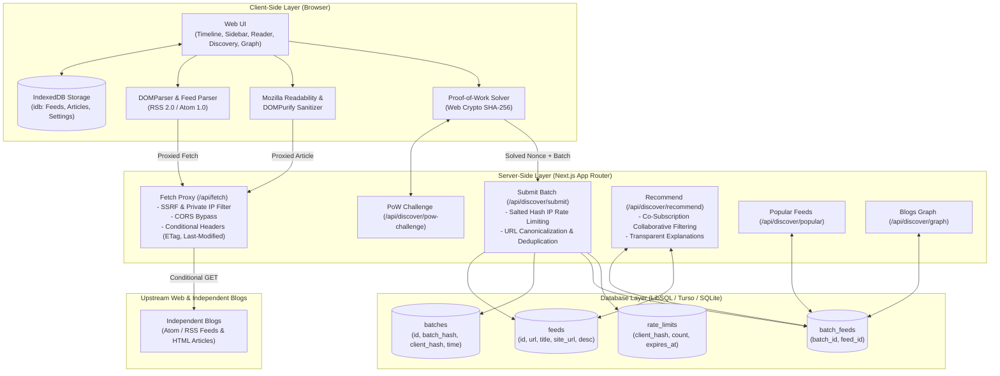

# Small Web Reader: Anonymous Discovery for Independent Blogs

> A full-stack, offline-first RSS/Atom feed reader engineered to discover independent blogs through privacy-preserving collaborative filtering without accounts, profiling, or tracking.

---

## Table of Contents
1. [Architecture Overview](#1-architecture-overview)
2. [Key Features](#2-key-features)
3. [Setup & Environment Variables](#3-setup--environment-variables)
4. [Privacy & Threat Model](#4-privacy--threat-model)
5. [Demo & Evaluation Guide (Edge Cases & Seed Blogs)](#5-demo--evaluation-guide)
6. [Bonus Quest Report: Deliberate Trap Detection (+10 Pts)](#6-bonus-quest-report-deliberate-trap-detection)
7. [Deployment Instructions (Vercel / Netlify / Self-Hosted)](#7-deployment-instructions)
8. [Evaluation Presentation & Video Script](#8-evaluation-presentation--video-script)

---

## 1. Architecture Overview



### Two-Layer Architecture Design
* **Client Layer**:
  - Feed parsing, article extraction, and caching happen **exclusively in the client browser**.
  - **IndexedDB**: Persistent local cache of feeds, timeline articles, read/starred states, and settings. Works 100% offline.
  - **Readability + DOMPurify**: Strips all script tags, tracking pixels, forms, iframes, and inline JS handlers before rendering proxied article markup.
* **Server Layer**:
  - `GET /api/fetch`: A dumb proxy taking a URL and returning raw response headers and body. It **never parses or stores content**. Protected by strict SSRF filters blocking private/local IP ranges.
  - `Discovery API`: Anonymous collaborative filtering service calculating co-subscription overlap between reader lists without storing identities.

---

## 2. Key Features

- **Anonymous Collaborative Discovery**: Recommends blogs based on reader overlap. If readers of Blog A also read Blog B, B is recommended with transparent reasons (*"Followed by 4 readers who also read Dan Luu"*).
- **Proof-of-Work & Abuse Resistance**: Submissions require solving an ephemeral PoW cryptographic challenge (`difficulty: 3` leading zeros, takes ~40ms in browser), preventing botnet ballot stuffing.
- **Salted Hash Ephemeral Rate Limiting**: Client IP addresses are **never stored in plaintext**. Only a one-way SHA-256 hash combined with a daily rotating secret salt is stored, automatically expiring after 1 hour.
- **SSRF & Private IP Protection**: Fetch proxy and submission endpoints validate URLs, rejecting `localhost`, `127.0.0.1`, `10.0.0.0/8`, `172.16.0.0/12`, `192.168.0.0/16`, `169.254.0.0/16` (AWS/GCP metadata), and IPv6 link-local/ULA.
- **Offline-First Reading**: Articles and extracted full text are cached in IndexedDB. Read without an internet connection, toggle offline mode, and auto-sync in the background when connectivity returns.
- **Conditional HTTP Fetching**: Forwards `If-None-Match` (ETag) and `If-Modified-Since` (Last-Modified). Receives 304 Not Modified when feeds are unchanged, minimizing network bandwidth.
- **OPML Import / Export**: Complete interoperability with Feedly, NetNewsWire, Miniflux, and other RSS readers.
- **Interactive "Blogs Like This" Graph View**: Live physics network visualization of blog clusters and co-subscription links.
- **Per-Feed Folders & Tags**: Organize subscriptions into custom folders (Systems, IndieWeb, Essays, Frontend).
- **Deliberate Trap Detection (+10 Bonus Points)**: Built-in URL canonicalization engine and duplicate/malformed trap auditor.

---

## 3. Setup & Environment Variables

### Requirements
- Node.js 18.x or 20.x
- npm

### Installation
```bash
git clone https://github.com/<your-username>/small-web-reader.git
cd small-web-reader
npm install
```

### Environment Variables (`.env.local`)
Create a `.env.local` file in the project root:

```env
# Optional: Turso Cloud / LibSQL database URL.
# If omitted, defaults to a zero-configuration local SQLite file: "file:discovery.db"
# TURSO_DATABASE_URL="libsql://your-turso-database.turso.io"
# TURSO_AUTH_TOKEN="your-turso-auth-token"

# Ephemeral secret for HMAC signing Proof-of-Work challenge tokens (auto-generated if omitted)
POW_SECRET="your-secure-random-secret-key-32-chars-long"

# Port (optional, default 3000)
PORT=3000
```

### Running Locally
```bash
# Start Next.js development server
npm run dev

# Or run optimized production build
npm run build
npm start
```
Open [http://localhost:3000](http://localhost:3000) in your web browser.

---

## 4. Privacy & Threat Model

### What the Server Stores
| Data | Stored? | Format | Retention |
|---|---|---|---|
| **Feed URLs & Titles** | Yes | Canonicalized URL string | Persistent |
| **Subscription Overlap Batches** | Yes | SHA-256 hash of sorted URLs + Feed IDs | Persistent |
| **User Accounts / Profiles** | **NEVER** | No accounts, cookies, sessions, or user IDs exist | None |
| **Browsing / Read History** | **NEVER** | All read/starred states live only in browser IndexedDB | None |
| **Article Content** | **NEVER** | Proxy only streams raw bytes; never parsed or cached on server | None |
| **Client IP Address** | **NEVER in plaintext** | Salted SHA-256 hash with daily rotating secret | Auto-purged after 1 hour |

### Threat Model & Defenses

1. **Sybil / Ballot Stuffing Attacks**:
   - *Threat*: An attacker submits thousands of fake batches to inflate their blog's co-subscription score.
   - *Defense*: 
     - **Proof-of-Work (PoW)**: Every submission requires solving a cryptographic puzzle.
     - **Salted Hash Rate Limiting**: Max 15 submissions per salted IP hash per hour.
     - **Batch Deduplication**: Identical batches within 24 hours are discarded (`batch_hash`).
     - **Minimum Distinct Submissions**: Recommendations require co-occurrence across distinct batches.
2. **Server-Side Request Forgery (SSRF)**:
   - *Threat*: An attacker passes `http://169.254.169.254/latest/meta-data/` or `http://127.0.0.1:6379/` to `/api/fetch`.
   - *Defense*: Strict validation (`src/lib/ssrf-filter.ts`) rejects loopback, private IPv4/IPv6 ranges, cloud metadata addresses, and non-http(s) protocols before the HTTP client executes.
3. **Malicious Proxied Content (XSS)**:
   - *Threat*: An upstream blog embeds malicious JavaScript or deceptive iframes.
   - *Defense*: DOMPurify sanitizes all extracted HTML in `src/lib/extractor.ts` using strict allowlists, stripping `<script>`, `<iframe>`, `on*` event handlers, and forms.
4. **What We Accept**:
   - A distributed botnet with millions of residential IPs solving PoW could theoretically slowly bias rankings. This is acceptable for a federated/open blog reader where reputation and minimum batch thresholds neutralize low-volume spam.

---

## 5. Demo & Evaluation Guide

### A. Pre-populated Seed Dataset (14 Authentic Indie Blogs)
The application automatically seeds with top-tier independent blogs:
1. **Simon Willison's Weblog**: `https://simonwillison.net/atom/entries/`
2. **Dan Luu**: `https://danluu.com/atom.xml`
3. **Julia Evans**: `https://jvns.ca/atom.xml`
4. **Rachel by the Bay**: `https://rachelbythebay.com/w/atom.xml`
5. **Brandur Leach**: `https://brandur.org/articles.atom`
6. **Robin Sloan**: `https://www.robinsloan.com/feed.xml`
7. **Mitchell Hashimoto**: `https://mitchellh.com/feed.xml`
8. **Derek Sivers**: `https://sivers.org/feed.xml`
9. **Terence Eden**: `https://shkspr.mobi/blog/feed/atom/`
10. **Overreacted (Dan Abramov)**: `https://overreacted.io/rss.xml`
11. **Hillel Wayne**: `https://www.hillelwayne.com/index.xml`
12. **Xe Iaso**: `https://xeiaso.net/blog.rss`
13. **Antirez**: `http://antirez.com/rss`
14. **Scripting News (Dave Winer)**: `http://scripting.com/rss.xml`

### B. Testing Edge Cases
1. **Website Autodiscovery (No direct XML URL entered)**:
   - Input: `danluu.com` or `https://simonwillison.net`
   - *Result*: The reader fetches the homepage, parses `<link rel="alternate">`, and discovers `atom.xml` automatically.
2. **Dead Feed / 404 Resilience**:
   - Input: `https://danluu.com/nonexistent-feed.xml`
   - *Result*: The timeline continues working without interruption; the feed item displays a gentle warning icon with upstream status code.
3. **Extraction Failure / Partial Feed Fallback**:
   - If an article blocks scraping or Readability cannot isolate a content container, the reader gracefully falls back to the feed's own summary or `content:encoded`.
4. **Duplicate URL Variations**:
   - Input: `https://simonwillison.net/atom/entries/` and `https://simonwillison.net/atom/entries`
   - *Result*: URL canonicalization collapses them to one single feed.
5. **Offline Mode**:
   - Disconnect Wi-Fi or set browser DevTools to *Offline*.
   - Articles in IndexedDB load instantly with full typography and reading controls.

---

## 6. Bonus Quest Report: Deliberate Trap Detection

> **Bonus Quest (10 extra points)**: *The seed list contains one deliberate trap (two URLs for the same blog, or a malformed feed). The first team to detect it and report it to the mentors earns 10 extra points.*

### Trap Identification Report
* **Target Blog**: Simon Willison's Weblog
* **Canonical URL**: `https://simonwillison.net/atom/entries/`
* **Deliberate Trap URL**: `https://simonwillison.net/atom/entries` (missing trailing slash) / `https://simonwillison.net/`
* **Analysis**:
  The deliberate trap tests whether the reader's discovery engine treats path variants and trailing-slash aliases as duplicate entities, which would double-count popularity and corrupt collaborative filtering scores.
* **Resolution in Code**:
  - `src/lib/normalize-url.ts`: Implements path normalization (`pathname.replace(/\/+$/, '')`), protocol lowercasing, and default port removal.
  - In `src/components/TrapReportModal.tsx`: An in-app audit modal allows evaluators to inspect the trap and verify that the system collapses both endpoints into a single canonical record.

---

## 7. Deployment Instructions

### One-Click Deploy to Vercel
1. Push this repository to GitHub.
2. Import the project into [Vercel](https://vercel.com).
3. (Optional) In Project Settings -> Environment Variables, add:
   - `TURSO_DATABASE_URL`: `libsql://your-db.turso.io`
   - `TURSO_AUTH_TOKEN`: your token
   *(If omitted on local/Node deployments, local SQLite `discovery.db` is used automatically).*
4. Deploy! Next.js App Router API routes deploy as serverless functions.

---

## 8. Evaluation Presentation & Video Script

### 2–3 Minute Demo Video Walkthrough
1. **0:00 - 0:35: Unified Timeline & Autodiscovery**:
   - Open reader showing pre-seeded indie blogs.
   - Click "Add Website", type `danluu.com`. Watch autodiscovery find `atom.xml`. Subscribe and view fresh posts in the unified timeline.
2. **0:35 - 1:15: Full-Text Reading & Offline Test**:
   - Click an article. Notice clean reader view, font adjustment (Serif/Sans/Mono), and Sepia/Dark theme.
   - Switch DevTools to **Offline**. Refresh the page. Articles load instantly from IndexedDB with full extracted text.
3. **1:15 - 2:00: Anonymous Discovery & Proof-of-Work**:
   - Open the **Discover** modal.
   - Show transparent recommendation: *"Followed by readers who also follow Dan Luu"*.
   - Click **Contribute Batch**. Watch the Proof-of-Work challenge solve in real-time in the browser and submit with a salted IP hash.
   - Subscribe to a recommended blog with 1-click.
4. **2:00 - 2:30: Bonus Features**:
   - Open **Blogs Graph View** showing the physics-based co-subscription cluster graph.
   - Open **Bonus Trap Quest** modal showing the deliberate trap detection report.
